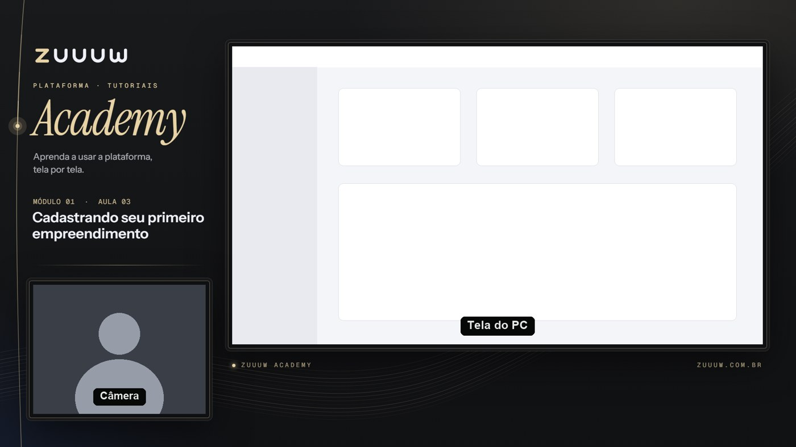
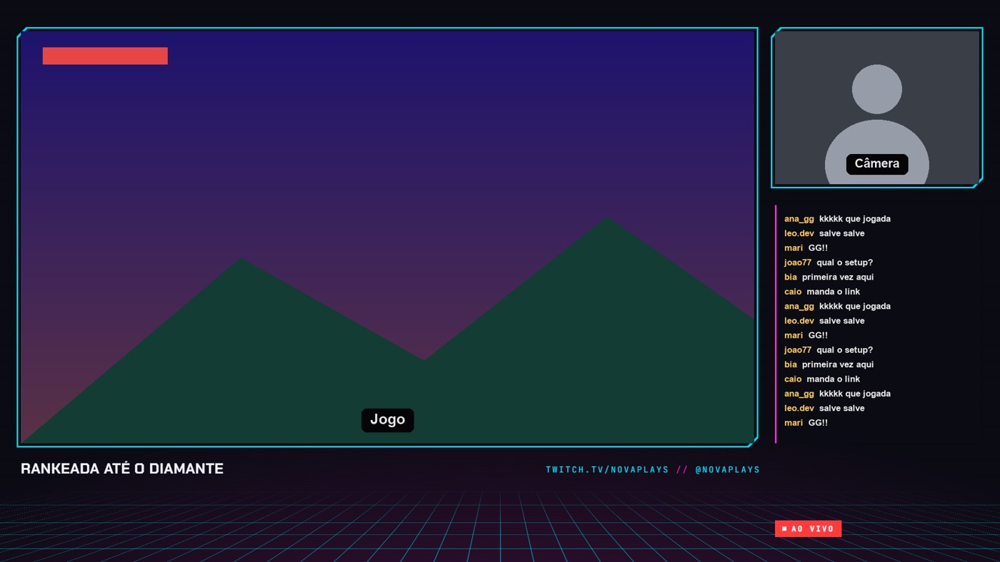
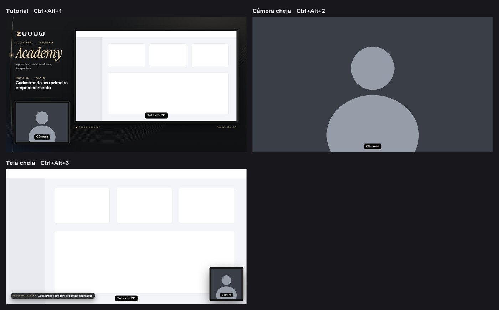
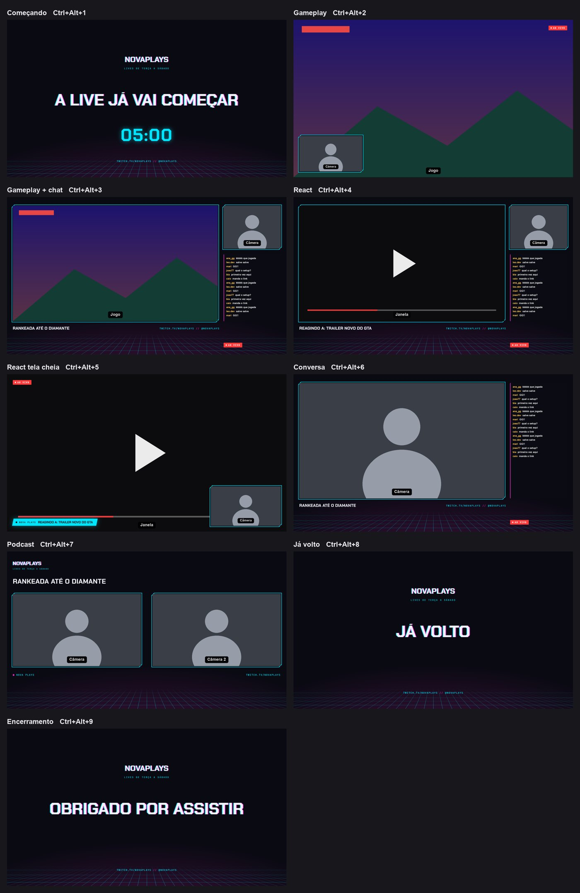

# obs-stream-scenes

**Uma skill pra sua IA virar designer e técnico do seu OBS.** Ela entrevista você sobre o que você faz
na câmera, estuda a sua marca (site, logo, redes, nicho), desenha telas que só fazem sentido pra você e
deixa o OBS pronto pra gravar ou entrar ao vivo, com cenas, fontes, áudio e atalhos configurados.

*An AI skill that interviews you, studies your brand and builds a complete, custom set of OBS scenes,
then configures OBS by itself. English below.*

<p>
  
  
</p>

Funciona com Claude Code, Codex, Cursor e outros agentes que leem skills no formato `SKILL.md`.

## O que ela faz

1. **Entrevista**: aula gravada, gameplay de PC ou console, react, podcast, live de conversa, webinar,
   live de vendas, vertical. Pergunta também sobre câmeras, microfone, monitores e chat.
2. **Estuda o cliente antes de desenhar**: lê o site e extrai as fontes e cores que a marca realmente
   usa, tira a paleta do logo, faz prints, olha redes e nicho. Depois escreve um brief com 2 ou 3
   direções visuais diferentes pra você escolher. Nada de fonte ou animação padrão: cada cliente ganha
   um tema próprio.
3. **Planeja as cenas** que você vai usar de verdade: Começando (com contagem regressiva), Gameplay com
   câmera, Gameplay + chat, React, React em tela cheia, Conversa, Podcast lado a lado, Tutorial, Tela
   cheia, Câmera cheia, Já volto, Encerramento... ou layouts sob medida.
4. **Gera as telas** como fontes de navegador animadas, com textos ao vivo (título da aula, "agora
   jogando", episódio) que você troca editando um `.txt`, sem mexer no OBS.
5. **Mostra prévias em PNG** de todas as cenas e ajusta até você aprovar.
6. **Configura o OBS sozinha** pelo WebSocket: perfil, coleção de cenas, resolução, fps, encoder,
   gravação em MP4 híbrido, bitrate de live, microfone com redução de ruído, compressor e limitador,
   áudio do PC, todas as fontes nas posições certas e os atalhos de teclado.

## Dois clientes, dois mundos

O mesmo motor, temas criados a partir de cada marca:

**Zuuuw Academy**: tutoriais gravados de uma plataforma imobiliária. Editorial, calmo, champanhe sobre grafite.



**NOVAPLAYS** (fictício): streamer de FPS. Quinas cortadas, ciano e magenta, grade em movimento.



## Instalar

```bash
npx skills add kayky05/obs-stream-scenes
```

Ou copie a pasta `skills/obs-stream-scenes` para a pasta de skills do seu agente (no Claude Code:
`~/.claude/skills/obs-stream-scenes`).

Depois é só pedir: *"monta as telas do meu OBS pra live de gameplay"*, *"quero cenas pra gravar meu
curso"*, *"refaz meu OBS com a cara da minha marca"*.

**Requisitos**: Python 3.10+, OBS 30+, Chrome ou Edge (pras prévias), `pip install obsws-python pillow`.
Testado no Windows; macOS e Linux usam os mesmos scripts, mas a captura de jogo só existe no Windows.

## Como funciona por dentro

```
skills/obs-stream-scenes/
  SKILL.md                 roteiro que a IA segue: entrevista, estudo, plano, tema, prévia, OBS
  references/              estudo de marca, contrato do tema, cenas, studio.json, setup do OBS
  scripts/
    inspect_brand.py       fontes, cores, redes e prints do site do cliente; paleta do logo
    build_kit.py           studio.json + tema -> camadas HTML de cada cena + studio.lock.json
    presets.py             a geometria de cada tipo de cena
    preview.py             PNG de cada cena, sem precisar do OBS
    enable_websocket.py    liga o WebSocket do OBS
    configure_obs.py       monta perfil, cenas, fontes e áudio (tem --dry-run)
    hotkeys.py             grava os atalhos
    set_text.py            troca um texto ao vivo
  templates/layer.html     o motor que posiciona tudo; o visual vem do tema do cliente
  examples/                dois kits completos (zuuuw-academy, novaplays), cada um com seu tema
```

Cada cliente vira uma pasta de kit com `studio.json` (marca, cores, fontes, cenas, aparelhos), um tema
(`theme/theme.css` + `theme/theme.js`), a pesquisa (`research/brief.md`) e os arquivos gerados.
Mudou alguma coisa? A IA edita o kit e roda os scripts de novo; eles atualizam o OBS sem duplicar nada.

A IA nunca pede nem grava chave de transmissão ou senha: a chave você cola no OBS.

---

## English

**A skill that turns your AI into the designer and technician of your OBS.** It interviews you about
what you do on camera, studies your brand (site, logo, socials, niche), designs scenes that only make
sense for you and leaves OBS ready to record or stream: scenes, sources, audio and hotkeys configured.

- **Interview**: recorded lessons, PC or console gameplay, react, podcast, just chatting, webinars,
  sales lives, vertical; cameras, mic, monitors, chat.
- **Brand study first**: extracts the fonts and colors the brand really uses from its site, the logo
  palette, screenshots, socials and niche, then writes a brief with 2-3 distinct directions. No default
  fonts or animations: every client gets its own theme.
- **Scene plan**: starting soon with countdown, gameplay with facecam, gameplay + chat, react, react
  full screen, just chatting, side-by-side podcast, tutorial, full screen, full camera, be right back,
  ending, or custom layouts.
- **Live texts** (lesson title, now playing) editable from a `.txt` while live.
- **PNG previews** of every scene before anything touches OBS.
- **OBS configured over WebSocket**: profile, collection, canvas, fps, encoder, hybrid MP4 recording,
  stream bitrate, mic with noise suppression/compressor/limiter, desktop audio, every source in place,
  hotkeys.

Install with `npx skills add kayky05/obs-stream-scenes` or copy `skills/obs-stream-scenes` into your
agent's skills folder. Requirements: Python 3.10+, OBS 30+, Chrome or Edge, `pip install obsws-python pillow`.

## License

MIT for the code. Fonts are downloaded at build time from Fontsource/Google Fonts under their own
licenses (listed in each kit's `fonts/LICENSES.md`). The Zuuuw logo in `examples/zuuuw-academy` belongs
to Zuuuw and is included only as an example.
